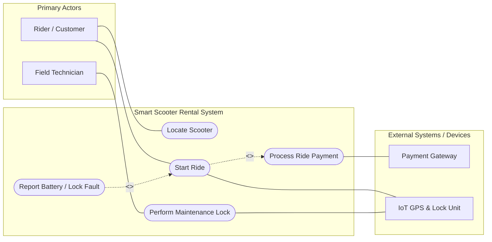
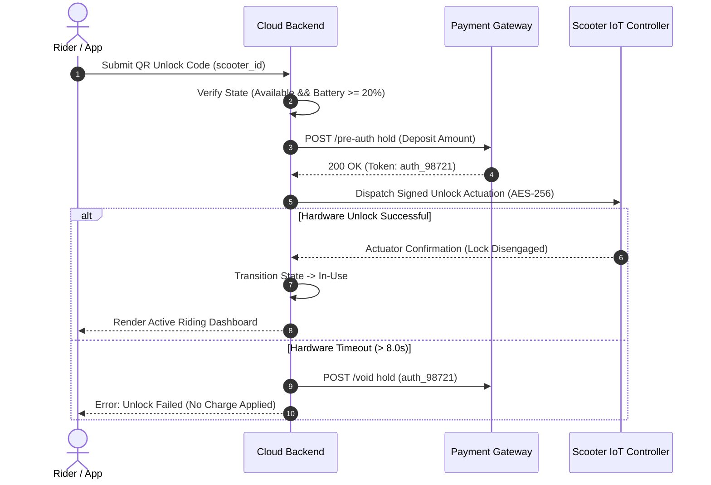
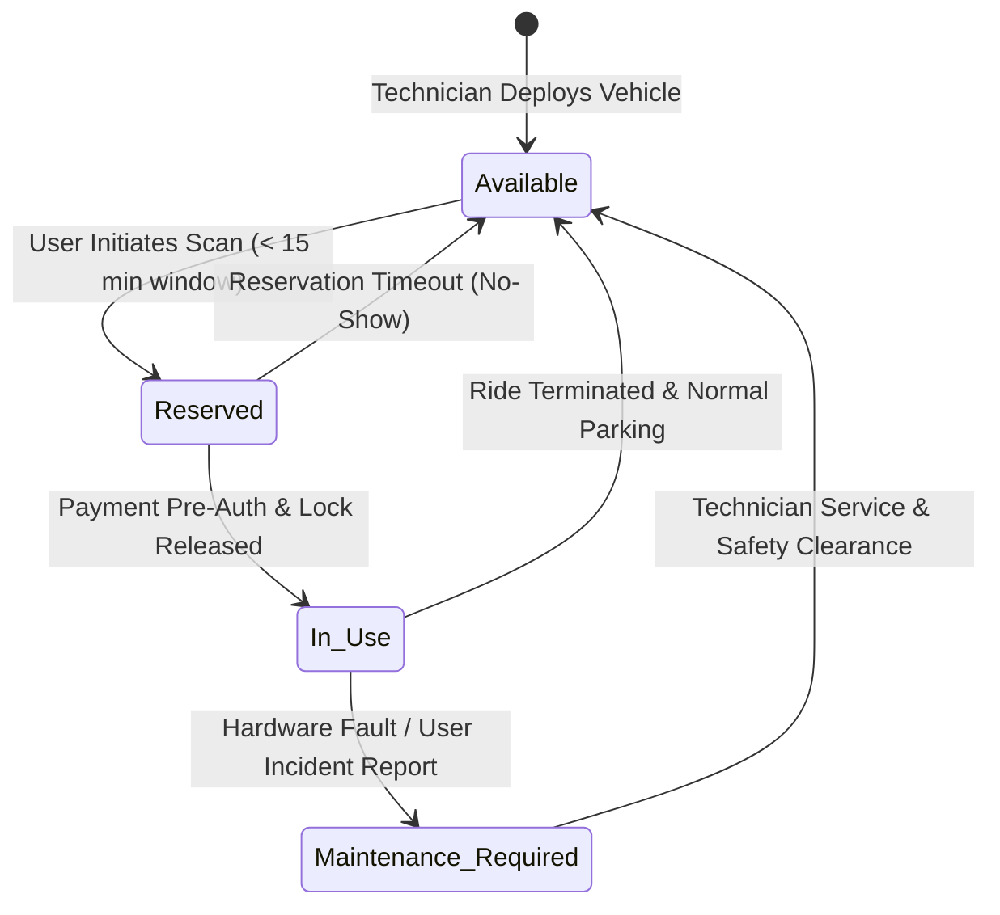

# System Requirements & Markdown Engineering Showcase
**Course:** Software Engineering Methods  
**Document Purpose:** Comprehensive Markdown & Mermaid Architecture Reference  
**Status:** `Approved Example` | **Version:** `2.0.0`

---

> **Architect's Note (Info Callout):**  
> This reference document demonstrates advanced Markdown elements, Mermaid.js behavioral models, and structured engineering artifacts used across industry-standard repositories.

---

## 1. System Context & Overview

### 1.1 Typography and Inline Highlights
Engineering documents require clear visual hierarchy:
* **Bold Terms:** Use for critical system entities like **Primary Actor**, **System Invariant**, and **Strict Threshold**.
* *Italic Text:* Use for state descriptions such as *pending pre-authorization* or *awaiting sensor heartbeat*.
* `Inline Monospace Code:` Use for explicit software constructs, database columns like `vehicle_id`, HTTP status codes `402 Payment Required`, or exceptions `TimeoutException`.
* ~~Strikethrough:~~ Use to explicitly document deprecated requirements or obsolete business rules (e.g., ~~Manual coin cash deposit allowed~~).

---

## 2. Interactive Task Tracking (Checklist)

Engineers use GitHub-flavored task lists to track sprint progress and lab phases:

- [x] Phase 1: Environment provisioning (IntelliJ IDEA Ultimate, Liberica Full JDK, Git).
- [x] Phase 2: Entity discovery, actor boundaries, and edge-case resolution via AI auditing.
- [x] Phase 3: Textual Use Case modeling in Mermaid.js with strict boundary subgraphs.
- [ ] Phase 4: Import into Visual Paradigm repository (`.vpp`) with full Flow of Events specification.
- [ ] Phase 5: Complete Requirements Traceability Matrix (RTM) and BDD acceptance verification.

---

## 3. Behavioral Modeling with Mermaid.js

### 3.1 Use Case Diagram (Boundary, Actors & Dependencies)


### 3.2 Sequence Diagram (End-to-End Unlock Protocol)


### 3.3 State Machine Diagram (Vehicle Lifecycle States)


---

## 4. Structured Engineering Tables

### 4.1 System Actor Catalog
| Actor Identifier | Actor Classification | Nature / Channel | System Role & Operational Responsibility |
| :--- | :--- | :--- | :--- |
| **`ACT-01`** | Primary Human | Mobile Application | Locates available units, reserves vehicles, and initiates rental sessions. |
| **`ACT-02`** | Secondary External System | REST API / Webhook | Validates payment instruments, executes pre-auth holds, and settles invoices. |
| **`ACT-03`** | Secondary Embedded Device | Cellular IoT (MQTT) | Monitors GPS coordinates, battery telemetry, and actuates physical wheel lock. |

### 4.2 Requirements Traceability Matrix (RTM Showcase)
| Req ID | Requirement Statement (RFC 2119 Syntax) | Type | Mapped Use Case | Verification Metric | Status |
| :--- | :--- | :---: | :--- | :--- | :---: |
| **`REQ-01`** | The system shall disengage hardware lock within 3.0s of payment verification. | `FR` | `UC_StartRide` | Latency $\le 3000\text{ ms}$ at P95 | `VERIFIED` |
| **`REQ-02`** | All over-the-air commands shall be encrypted using AES-256-GCM. | `NFR` | `UC_StartRide` | Zero cleartext packet audit | `COMPLIANT` |
| **`REQ-03`** | The system shall automatically void holds within 2.0s upon unlock failure. | `NFR` | `UC_StartRide` | Zero orphaned credit holds | `PENDING` |

---

## 5. Behavior-Driven Development (BDD / Gherkin Syntax)

```gherkin
Feature: Automated Transactional Rollback on Actuation Failure
  As a registered scooter rider
  I want my temporary payment hold immediately reversed if the vehicle lock fails
  So that I am never billed for a ride I could not take

  @Critical @Reliability @TEST-08
  Scenario: IoT mechanical lock fails to release within timeout window
    Given a registered user has initiated an unlock sequence for vehicle "SC-104"
    And a temporary deposit hold of 20.00 NIS was approved by the Payment Gateway
    When the vehicle IoT controller fails to acknowledge unlock within 8.0 seconds
    Then the cloud backend must immediately trigger an automated compensating transaction
    And the payment gateway deposit hold must be voided within 2.0 seconds
    And vehicle "SC-104" operating state must transition to "Maintenance_Required"
    And the mobile app must render an error: "Hardware release failed. No charge applied."
```

---

## 6. Collapsible Deep Dives (HTML Accordions)

<details>
<summary><b>Click to expand: Concurrency Lock Resolution Protocol</b></summary>

### Distributed Locking Strategy
When concurrent requests target the same resource:
1. The backend issues an atomic update query with a version stamp:
   ```sql
   UPDATE vehicle_inventory 
   SET status = 'RESERVED', version = version + 1 
   WHERE vehicle_id = :id AND status = 'AVAILABLE' AND version = :current_version;
   ```
2. If rows affected equals `0`, the request aborts with an immediate `409 Conflict`.
3. The failed thread routes the user to the nearest spatial neighbor within a 200m radius.
</details>

<details>
<summary><b>Click to expand: Non-Functional Requirements FURPS+ Classification</b></summary>

* **F - Functionality:** Core business logic, error handling, security invariants.
* **U - Usability:** Mobile screen response, onboarding speed, error readability.
* **R - Reliability:** MTBF, MTTR, zero-data-loss rollback mechanisms.
* **P - Performance:** Latency bounds, throughput targets, concurrency limits.
* **S - Supportability:** Modularity, API versioning, automated container deployment.
* **+ Constraints:** Legal compliance (GDPR, PCI-DSS), hardware battery thresholds.
</details>