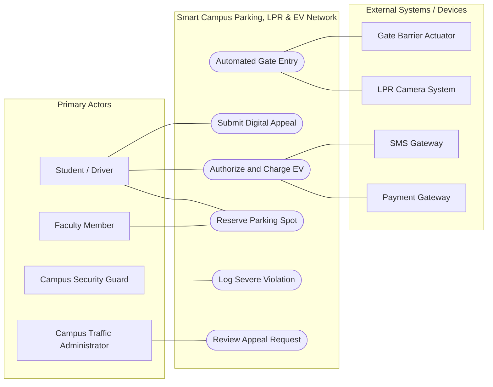

# Requirements Architecture & System Specification
**Course:** Software Engineering Methods  
**System:** Smart Campus Parking, LPR, and EV Network  
**Submission Date:** [Insert Date]  

### Engineering Team Details
* **Student 1:** [Full Name] | **ID:** [ID Number] | **Braude Email:** [username@braude.ac.il]
* **Student 2:** [Full Name] | **ID:** [ID Number] | **Braude Email:** [username@braude.ac.il]

---

## 1. System Use Case Diagram (Mermaid.js)

<!-- 
INSTRUCTIONS FOR STUDENTS:
1. Populate the Mermaid flowchart below based on your audited entities from Part 1, Step 4.
2. Group human actors inside Primary_Actors and hardware/external systems inside Secondary_Actors.
3. Place all core Use Cases inside the ParkingSystem boundary subgraph.
4. Use solid lines without arrows (---) for Actor associations.
5. Use dashed arrows with explicit stereotypes for dependencies:
   - Include: BaseUC -.->|"<<include>>"| IncludedUC
   - Extend:  ExtendingUC -.->|"<<extend>>"| BaseUC
-->

---

## 2. Business Edge Cases & Concurrency Decisions

<!-- 
INSTRUCTIONS FOR STUDENTS:
Select at least two unresolved business ambiguities, concurrency edge cases, or hardware timeouts 
identified during your AI auditing phase. Document your architectural decision in English below.
-->

### Edge Case 1: [Descriptive Title - e.g., Concurrent EV Spot Reservation]
* **Scenario & Ambiguity:** [Describe the collision, race condition, or missing system rule]
* **Architectural Resolution:** [Define the exact logic, optimistic/pessimistic lock, and system behavior]
* **Impact on System State:** [Detail changes in database records, timer expirations, or notifications]

### Edge Case 2: [Descriptive Title - e.g., Vehicle Idle Violation Timeout & Disconnect]
* **Scenario & Ambiguity:** [Describe the collision, race condition, or missing system rule]
* **Architectural Resolution:** [Define the exact logic, penalty calculation, and system behavior]
* **Impact on System State:** [Detail changes in user ledger, SMS dispatches, or account warning flags]

---

## 3. Requirements Traceability Matrix (RTM)

<!-- 
INSTRUCTIONS FOR STUDENTS:
1. Formulate atomic, single-responsibility requirements using RFC 2119 ("shall") and EARS syntax.
2. Maintain the starter rows below and ADD at least:
   - 2 more Functional Requirements (FR) to reach a total of at least 3 FRs.
   - 2 more Non-Functional Requirements (NFR) to reach a total of at least 3 NFRs.
3. Every NFR MUST contain an explicit, measurable numeric threshold or SLA latency limit.
-->

| Req ID | Requirement Description (Clean English with "shall") | Type (FR/NFR) | Mapped Use Case | Test ID |
| :--- | :--- | :---: | :--- | :---: |
| **REQ-01** | The system shall automatically cancel a reservation if the LPR camera does not detect vehicle entry within exactly 15 minutes. | FR | UC_ReserveSpot | TEST-01 |
| **REQ-02** | The payment gateway authorization shall return a verification token within a maximum latency of 2.5 seconds under peak load. | NFR | UC_ChargeEV | TEST-02 |
| **REQ-03** | The system shall apply a charger idle penalty of 5 NIS per hour starting 30 minutes after 100% charging completion. | FR | UC_ChargeEV | TEST-03 |
| **REQ-04** | [Add Functional Requirement - e.g., dynamic zone filtering for Students vs. Faculty] | FR | [Mapped UC] | TEST-04 |
| **REQ-05** | [Add Functional Requirement - e.g., guard violation logging and account ledger attachment] | FR | [Mapped UC] | TEST-05 |
| **REQ-06** | [Add Non-Functional Requirement - e.g., LPR plate scan recognition time threshold] | NFR | [Mapped UC] | TEST-06 |
| **REQ-07** | [Add Non-Functional Requirement - e.g., SMS dispatch latency or database availability SLA] | NFR | [Mapped UC] | TEST-07 |

---

## 4. BDD Acceptance Tests (Given-When-Then)

<!-- 
INSTRUCTIONS FOR STUDENTS:
Author two complete BDD acceptance tests corresponding to the Test IDs in your RTM table.
- Test 1: Happy Path Operational Flow.
- Test 2: Exception, Fault, or Automated Penalty Flow.
-->

### Acceptance Test [TEST-01]: LPR Successful Gate Entry (Happy Path)
* **Given:** A student has an active parking permit and their vehicle approaches the entrance gate.
* **When:** The LPR camera successfully scans and matches the registered license plate.
* **Then:** The system must send an automated command to open the barrier gate.
* **And:** The system must record the exact entry timestamp in the access audit log.

### Acceptance Test [TEST-03]: Charger Idle Penalty Enforcement (Exception / Timeout)
* **Given:** An electric vehicle has reached 100% battery charge at an EV terminal and an SMS alert was dispatched.
* **When:** Exactly 30 minutes and 1 second elapse without the charging cable being disconnected and vehicle moved.
* **Then:** The system must start accruing an idle penalty fee of 5 NIS per hour.
* **And:** The accrued fee must be automatically attached to the owner's billing account ledger.

---

## 5. Pre-Submission Self-Audit Checklist

Before compressing your final ZIP archive (`ex1_ID1_ID2.zip`), verify compliance:

- [ ] All sections of this document are completed exclusively in professional English.
- [ ] The Mermaid diagram renders without errors in IntelliJ's Split Preview window.
- [ ] Dependencies (`<<include>>` and `<<extend>>`) have arrows pointing in the architecturally correct directions.
- [ ] At least two resolved business edge cases are documented with state impact.
- [ ] The RTM contains at least 3 FR and 3 NFR rows, with all NFRs having explicit numeric thresholds.
- [ ] Acceptance Test IDs (`TEST-XX`) strictly match the corresponding entries in the RTM table.